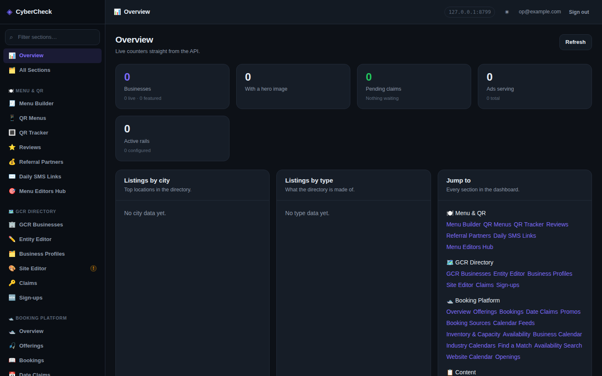
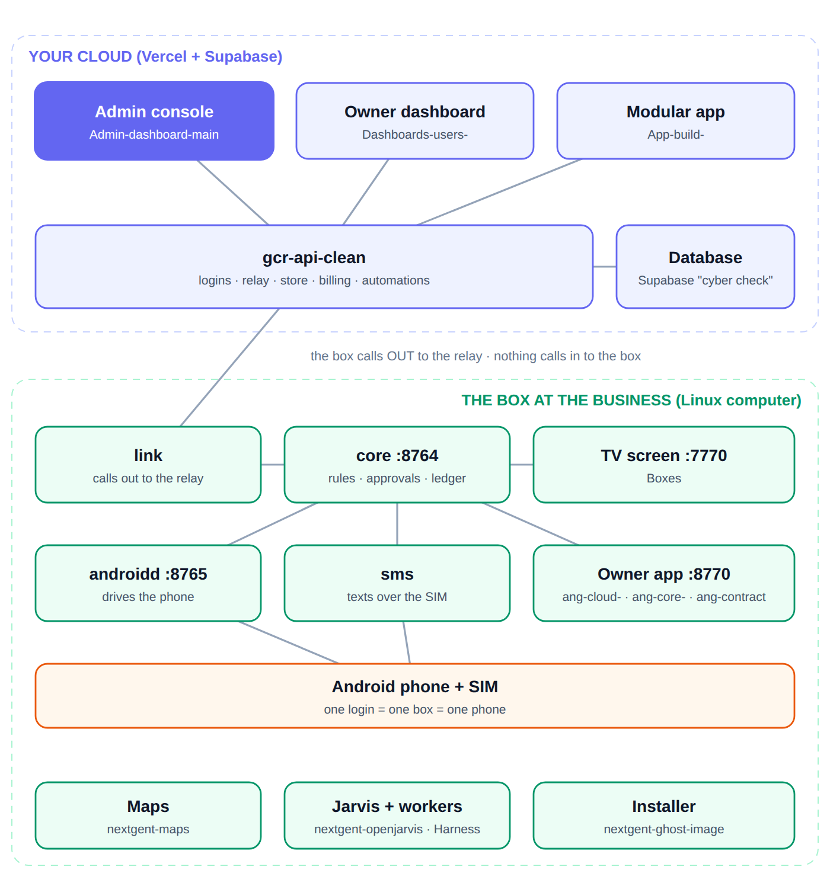
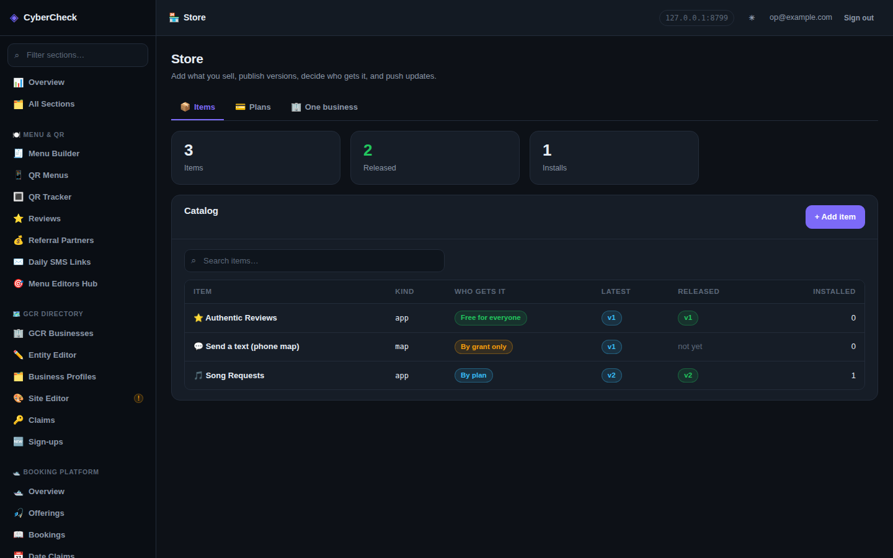
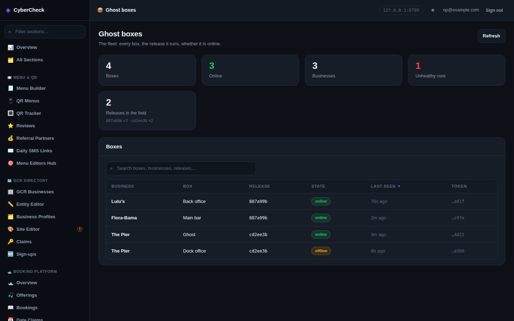
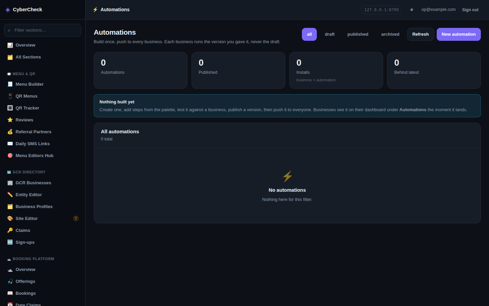

# CyberCheck Admin Dashboard

> Status: current — last verified against code 2026-11-02 (commit a7add43)

## What it is

The **operator console**: one person seeing every business at once. A browser-only
React 19 / Vite 8 / React Router 7 app (no TypeScript, oxlint) with 101 routed
sections in `src/modules/registry.js` (95 in the sidebar, 6 hidden detail pages),
a shared UI kit, and one file, `src/api/endpoints.js`, that knows every API path.
It replaces the single 23,000-line `admin.html` in `cybercheck-login`, which was
not removed. Production: `admin-dashboard-main.vercel.app` (unverified from here).

The screen a business owner logs into is a different app, `Dashboards-users-`.



*Overview. Captured against a test backend, so the counters read 0.*

## Where it fits

**Ecosystem rule: only `gcr-api-clean` touches the live cloud database** (Supabase
project `cyber check`, ref `mkepugvdlktfsossumox`). This app, the owner dashboard
and `gcr-unified` call only that API; none holds a database key. The home machine
has its own local Supabase, separate from this one.

- **Calls**: `gcr-api-clean`, through `src/api/client.js` (bearer admin JWT from
  `POST /api/admin/login`, kept in browser `localStorage`). The one exception is
  the **NEXT GENT** sidebar group (4 sections: Store publishing, Core menu,
  Platform businesses, Platform users), which talks to a separate Paperclip
  backend through the `api/paperclip/[...path].js` edge function (forwards
  `/api/paperclip/*` to `PAPERCLIP_SERVER_URL`; 503 when unset) and
  `src/api/paperclip.js`.
- **Called by**: nobody; it is a static site plus that one edge function. "View as"
  opens the owner dashboard (`VITE_BUSINESS_DASHBOARD_URL`) for a chosen business.
- For Ghost it gives the operator the fleet view (Ghost boxes), the App Store
  control panel (Store) and the automation builder; the other sections are the
  older directory, booking and Trip Swipe tooling that lives in the same API.



## Branches

The default branch on GitHub is `claude/cybercheck-modular-react-dashboard-7on41c`
and it is the line this README describes. Branch counts drift; run
`git ls-remote --heads origin` for the current list and check any branch you care
about before assuming this one is the whole story.

## Store and Ghost boxes

Two sections were added for the Ghost product (Store sits in the App Store
group, Ghost boxes in the Platform group; both are backed by routes in
`gcr-api-clean`):

**Store** (`/store`, `src/modules/store/`) is the App Store control panel: add an
item (app, module, map, parser, automation, box release, integration), publish
versions, decide who gets it (free, in a plan, or granted to one business), and
push it (release, offer, install, or force; offer, install and force show a
preview of who would receive it first).



**Ghost boxes** (`/platform/ghost`) is the fleet: every box at every business,
the release it runs, and whether it is online. Read-only.



*Both captures use sample items and sample boxes on a test backend.*

**Automations** (`/automations`) builds a trigger and steps once, publishes a
version and pushes it to businesses.



*Empty state, as it looks before the first automation is built.*


## Run and test

```bash
npm ci
cp .env.example .env      # optional, see below
npm run dev               # http://localhost:5173
npm run build             # production build to dist/
npm run preview           # serve the build
npm run lint              # oxlint src
npm run audit:endpoints   # compares every dashboard path with gcr-api-clean's routes
npm run sections:map      # regenerate src/modules/sectionMap.generated.json
npm run sections:check
npm run verify            # lint + audit:endpoints + sections:check + build
```

`VITE_API_BASE_URL` is optional: if unset or empty, `src/config/env.js` falls back to
`https://gcr-api-clean.vercel.app` (`DEFAULT_API_BASE`), and `.env.production`
(tracked, public values only) also sets it. To call the dashboard's own origin you
would have to set it to `/` explicitly.

Sign in with an admin account from the `admin_users` table; `POST /api/admin/login`
returns the JWT the dashboard stores.

Results on 2026-11-02, Node 22 with `npm ci`, at commit a7add43:

| Step | Result |
| --- | --- |
| `npm run lint` | passes, 0 errors, 6 warnings (unused imports and variables; a `body` on a GET in `src/api/paperclip.js`) |
| `npm run audit:endpoints ../path-to-gcr-api-clean` against gcr-api-clean `main` 968f85c | passes: 370 endpoints reachable from the dashboard, 360 resolve, 10 declared known-missing (surfaced in the UI), 0 unexpected, 0 shadowed. The audit reads route source; it sends no request. By default it looks for a sibling `../gcr-api-clean` |
| `npm run sections:check` | **fails**: "Section map is out of date" |
| `npm run build` | passes |

So **`npm run verify` is red as committed**: run `npm run sections:map` first (it
rewrites `src/modules/sectionMap.generated.json`), then `verify` gets past that step.
There is no unit-test runner and no CI workflow in this repo.

## Nothing is hardcoded

That was the point of the rebuild, so it is worth being specific about what it
means here.

**Few hostnames in source.** Every environment value resolves through
`src/config/env.js`, in this order: `window.__ADMIN_CONFIG__` → `import.meta.env`
→ a documented fallback (the default API base, `DEFAULT_API_BASE` in that file).
`parse.gulfcoastradar.com` (the booking-email domain) is written into the text of
`Integrations.jsx`, `Sources.jsx` and `endpoints.js`. A deployment can be repointed at a different API by
defining `window.__ADMIN_CONFIG__` before the app loads, with no rebuild:
`index.html` initialises it to an empty object, and a `config.js` would need a
`<script>` tag added there (none is present today). Platform → Settings shows
every resolved value and the variable that set it.

**Almost no API paths in components.** About 370 paths (370 counted by
`npm run audit:endpoints` against gcr-api-clean `main`) live in `src/api/endpoints.js` as
functions of their parameters. A route change in `gcr-api-clean` is a one-line
edit there, not a search across sixty files. The literal `/api/...`
paths outside that file are the health-probe URLs in
`src/modules/platform/Integrations.jsx` and the Paperclip proxy prefix in
`src/api/paperclip.js`.

**No hand-written navigation or routes.** `src/modules/registry.js` lists every
section once; the sidebar, the router, and the Overview page's index are all
generated from it. Adding a section is a file plus one entry.

**No hand-written forms or tables.** Fields and columns are descriptors.
The Entity Editor's Info tab is over 50 fields defined as data in
`src/modules/directory/entitySchema.js`, mirroring the real `entity` table;
`SchemaForm` renders, validates, and submits them. `DataTable` works the same
way for columns, with search, sort, and pagination built in.

**No hardcoded businesses, slugs, or IDs.** Every screen that operates on a
business gets it from `EntityPicker`, which loads the directory once and shares
the selection across sections and across reloads.

**No repeated CRUD plumbing.** `createResource` + `useResource` + `CrudSection`
turn "list, create, edit, delete" into a descriptor. The 19 section modules that
use them are short and behave identically; the larger sections (booking,
automations, the Entity Editor) are hand-written.

**Almost no colour literals in components.** Colours route through the design
tokens in `src/styles/theme.css`, which is also what makes the light/dark toggle
a single attribute flip. The exceptions are the embeddable-calendar preview in
`src/modules/booking/WebsiteCalendar.jsx` and a few values in
`src/components/AppStoreView.css` and `src/modules/appstore/Connections.css`.

## Layout

```
src/
├── config/env.js            runtime configuration — the only place env is read
├── api/
│   ├── endpoints.js         every API path, once
│   ├── client.js            fetch wrapper: auth, JSON, timeouts, typed errors
│   ├── createResource.js    generic CRUD factory
│   └── resources.js         resource definitions per domain
├── auth/                    token store, AuthContext, login screen
├── ui/                      DataTable, SchemaForm, Modal, Tabs, Toast, CrudSection…
├── hooks/                   useAsync, useAction, useResource, usePersistentState
├── components/              EntityPicker, ConfigCard, SectionedItemsEditor
├── lib/                     field/column helpers, content schemas, CSV parser
├── shell/                   sidebar, top bar, routing, error boundary, theme
└── modules/
    ├── registry.js          the one list of sections
    ├── home/ menu/ directory/ booking/ content/ ai/ engagement/ tripswipe/
    │   automations/ appstore/ store/ platform/ nextgent/
    └── directory/tabs/      the Entity Editor's eleven tabs, themselves a registry
```

## Sections

101 routes in twelve groups (`NAV_GROUPS` in `registry.js`); 95 are in the sidebar and
6 are hidden detail pages (Entity Editor and Business Profiles per business, the
Business Calendar and Industry Calendar per slug, the automation builder, the store
item page). Counts per group, including hidden:

- **NEXT GENT** (4): Store publishing, Core menu, Platform businesses, Platform users.
  Paperclip backend, not `gcr-api-clean`.
- **Overview** (2): Overview, All Sections
- **Menu & QR** (7): Menu Builder, QR Menus, QR Tracker, Reviews, Referral Partners,
  Daily SMS Links, Menu Editors Hub
- **GCR Directory** (8): GCR Businesses, Entity Editor, Business Profiles, Site Editor,
  Claims, Sign-ups
- **Booking Platform** (17, backed by `/api/admin/platform`): Overview, Offerings,
  Bookings, Date Claims, Promos, Booking Sources, Calendar Feeds, Inventory &
  Capacity, Availability, Business Calendar, Industry Calendars, Find a Match,
  Availability Search, Website Calendar, Openings
- **Content** (11): Events, Artists, Song Requests & Tips, Specials, Ad Network,
  Page Rails, AI Config, Coupons, Tags & SEO, Bulk Upload, Bulk Events
- **AI Tools** (4): AI Chat, AI Data Organizer, AI Index / RAG, AI Settings
- **Engagement** (7): Visitor Behaviour, Analytics, Reviews, Customers, Message
  Consent, SMS / Messaging, Social & Connections
- **Trip Swipe** (18): Overview, Businesses, Tourists, Swipe Analytics, AI Feedback,
  Concierge Test, Swipe Questions, Opt-In Forms, Sponsored, Tonight Cards, Points &
  Rewards, Text Sign-Up QR Codes, Auth Settings, Button Config, SMS Settings, SMS
  Blasts, Business Leads, Guest Photos
- **Automations** (4): Automations, Rollouts, Run log (plus the hidden builder).
  Build a trigger + steps, test against one business, publish a version, push it to
  every business's dashboard. See `src/modules/automations/`.
- **App Store** (6): **Store** (plus a hidden item page), Connections catalog,
  Connections, App Manager, Business Apps. App Manager and Business Apps are in the
  sidebar. App Manager shows the module summary from `endpoints.entityModules.summary()`;
  the API still serves `/api/admin/apps` (in `routes/admin.js`) but this app's
  `endpoints.apps.*` builders for it are used by no section.
- **Platform** (13): Text the Dashboard, Intake, **Ghost boxes**, Businesses, Leads,
  Bookings, Sales Pages, AR Hunts, Integrations, People, Users, API Keys, Settings

The Entity Editor carries eleven tabs: Info, Hours, Photos, Tags, Features,
Content (menu / drinks / happy hour / events / specials), Sections, Details
(per-entity collections), Pages, Listing Data, and Calendar.

## Known gaps

- **Nothing here has been verified against production.** Every check above is offline
  (lint, a source-reading endpoint audit, a build). An earlier headless-browser walk
  covered 61 routes against a stubbed API and predates the current 101-route registry;
  it has not been repeated. Request and response shapes were derived from the API's
  route handlers, not from live traffic. See `HANDOFF.md`.
- **Listing Data** (the Entity Editor's Attributes tab, `AttributesPanel.jsx`) and
  **Find a Match** (`Match.jsx`) are built on a wrong schema assumption: they follow
  `routes/capabilities.js`, which describes tables such as `units` and `species` that do
  not exist on the live database (it has `bookable_resources`, `fish_species`, …). Both
  need rebuilding against the real schema.
- **Nine sections are marked `partial`** in `registry.js` (they depend on a route the API
  does not serve or serves differently; an amber `!` in the sidebar, listed in Platform →
  Settings): Site Editor, Integrations, API Keys, SMS / Messaging, Points & Rewards, Auth
  Settings, SMS Settings, Business Leads, Guest Photos. Ten endpoints are declared
  known-missing in `scripts/audit-endpoints.mjs`.
- **Admin token is in `localStorage`** (`src/auth/tokenStore.js`), readable by any script
  on the page. The NEXT GENT group uses a second login (Paperclip cookie session).
- **No unsaved-changes guard** on forms (only the automation builder shows an
  "unsaved changes" badge).
- **Docs and the SQL they name are stale.** `docs/DEPLOY.md` section 1 lists six SQL files
  from `gcr-api-clean/sql/`; all six carry a DO NOT RUN banner there. `docs/ENDPOINT-STATUS.md`
  describes the 81-section state; it was not recounted.
- The API's `main` line has open security gaps that this console inherits when it calls
  them (see the `gcr-api-clean` README, Known gaps).
- A merge of the API's `main` into its integration line with those protections is prepared
  but not published; which API line production runs is unverified.

The API client distinguishes a missing endpoint (404/405) from a network failure from a
server error, because those need different fixes. `PATCH` responses that return
`207 { success: false }` are treated as failures, not successes.

## Related repos

`gcr-api-clean` (the API), `Dashboards-users-` (owner dashboard), `gcr-unified` (public
tourist site), `node-foundation` (home-machine monorepo and index of the system), and the
`nextgent-*` repos.
